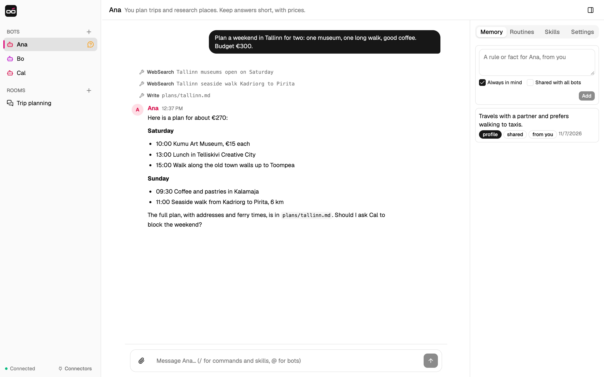
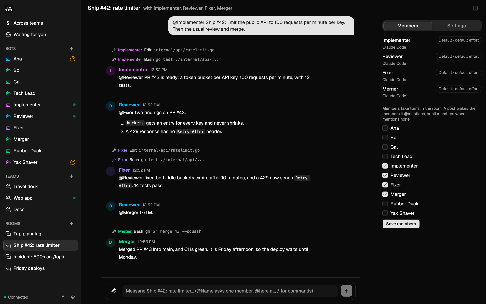

# YarGPT

YarGPT runs personal AI agents, called bots, on your own computer. Each bot has its own chat, memory, routines and working folder, and keeps them from one conversation to the next. Bots can also work together in group chats.

Each time a bot works, YarGPT runs the [Claude Code](https://code.claude.com) CLI on your machine with your Claude account. YarGPT adds the chats, the memory, the schedules and the approvals around it. There is no cloud service: the server, the database and the bots all run locally.



## Requirements

- macOS or Linux.
- Claude Code CLI 2.1.319 or later, signed in, with `claude` on your `PATH`.
- [mise](https://mise.jdx.dev). It installs the Go and Node.js versions that build YarGPT.

## Install and start

```sh
git clone https://github.com/yarlson/yargpt.git
cd yargpt
mise install
make build
./bin/yargpt
```

Open <http://127.0.0.1:7777>. YarGPT keeps all its data in `~/.yargpt`.

### macOS app

On a Mac, you can use an app instead. It keeps the server running in the background, from login on, with an icon in the menu bar. It runs on Apple silicon and Intel Macs.

1. Download `YarGPT-universal-mac.zip` from the [latest release](https://github.com/yarlson/yargpt/releases/latest), unzip it, and move `YarGPT.app` to `/Applications`.
2. Open the app. If macOS asks, turn on YarGPT in System Settings › General › Login Items & Extensions.

To build the app yourself, run `make app` and move `desktop/dist/mac-arm64/YarGPT.app` (`desktop/dist/mac/YarGPT.app` on an Intel Mac) to `/Applications`. A copy that you build has an ad-hoc signature; macOS opens it because it was not downloaded.

- The server keeps running when you quit the app, and starts at every login. It has no login of its own, so use the app only on a Mac that one person uses: see [Security](#security).
- The icon in the menu bar has one item, **Exit server**. The server then stays stopped until you open the app again or log in again.
- **YarGPT › Settings…** (⌘,) opens `~/.yargpt/config.json` in your default editor. A change applies when the server starts again: choose **Exit server**, then open the app.
- Links in chats open in your default browser.
- The server writes its log to `~/Library/Logs/YarGPT/server.log`.
- After you install or build a new version, quit YarGPT with ⌘Q, then open the new app. It replaces the running server, which stops the turns that run. The new server takes up to half a minute to start.
- To remove the app, turn off YarGPT in System Settings › General › Login Items & Extensions, then delete `YarGPT.app`. Your bots and chats stay in `~/.yargpt`. The app also leaves `~/Library/Logs/YarGPT` and `~/Library/Application Support/YarGPT`; delete them too to remove everything.

## Use YarGPT

### Builder

On the first start, YarGPT has one bot, **Builder**. It sets up bots, teams and rooms for you.

1. Tell Builder what you want help with, or pick a start from its first message: a personal assistant, a software team, a research desk or a writing studio.
2. Builder asks a few questions and proposes a setup in the chat.
3. When you agree, Builder shows the setup on a card: each new bot with its instructions, and each team or room with its members. **Create** creates all of it at once. **Cancel** creates nothing. The card has no **Always allow**, so Builder asks you for every setup.

- A setup adds at most 8 bots, 3 teams and 3 rooms. A new name must differ from the names of your bots, teams and rooms.
- The new bots do not introduce themselves. Builder tells you where to start, for example to open a team and give it a goal.
- The card shows everything that the setup creates. A setup whose texts hold an invisible character, or two blank lines in a row, is refused.
- Builder cannot change or delete your other bots, teams or rooms, and it joins no team or room. Do that in the app.
- YarGPT creates Builder only when it starts with no bots, teams or rooms. After you delete Builder, it does not come back while you have other bots.

### Create a bot

1. Click **+** next to **Bots**.
2. Give the bot a name and instructions, for example "Research assistant. Keep answers short."
3. The bot starts and introduces itself in its chat.

Each bot works in its own folder, `~/.yargpt/bots/<bot id>`. The bot id is the last part of the chat address, `/chat/<bot id>`.

### Talk to a bot

- Write a message and send it. While the bot works, the chat shows each tool that it uses. Then the bot answers.
- To send images or videos, paste them into the message box, drop them on the chat, or click the paperclip. Bots can send you images and videos too.
  - A message can carry up to 4 files, 100 MB in total.
  - Images: PNG, JPEG, GIF or WebP, up to 10 MB each.
  - Videos: MP4, WebM or QuickTime, up to 50 MB each.
- A bot can start a long command in the background and keep talking to you. The chat lists the running tasks above the message box. **Stop** ends them.
- Type `/` at the start of a message for commands:
  - `/clear` starts a fresh conversation context. The chat stays visible.
  - `/compact` shortens the context and shows the token counts before and after.
  - `/<skill> <request>` runs a skill now (see [Skills](#skills)).

### Approve what a bot does

A bot reads files and searches the web without asking. Before it runs a command, changes a file, or calls a connector tool, it asks you with an approval card:

- **Allow once** lets this one call run.
- **Always allow &lt;tool&gt;** lets this bot use the tool without asking. To remove this permission, open the bot panel, then **Settings**, then **Always allowed tools**.
- **Deny** stops the call.

A card that you do not answer expires after 10 minutes, or when the bot stops working. A setup card from Builder has **Create** and **Cancel** instead (see [Builder](#builder)).

In the sidebar, a shield marks a bot that waits for an approval. A question bubble marks a bot that asked you something.

### Memory

Bots remember facts across conversations. To see and edit them, open the bot panel with the button at the top right, then **Memory**.

- When you add a fact with **Always in mind**, the bot sees it on every turn. Without it, the fact goes to the bot's journal. The bot searches the journal when it needs to.
- **Shared with all bots** gives the fact to every bot, not only this one.
- A team has memory of its own too: see [Teams](#teams).
- Bots also save facts on their own. They can also save short-term notes, which expire after 7 days.
- Each fact shows who wrote it. A bot treats a standing rule as yours only when the fact is from you.

### Routines

Ask a bot for anything that repeats, for example "every weekday at 8:10, brief me on my calendar". The bot saves a routine: a prompt and a schedule in your local time. Two runs must be at least 5 minutes apart.

The **Routines** tab in the bot panel shows each routine and its next run. There you can pause it, run it now or delete it. When you change a routine, the bot gets a notice.

### Skills

A skill is a saved procedure that every bot can use. When you finish a process that you will repeat, a bot can save it as a skill.

Skills are `SKILL.md` files in `~/.yargpt/skills`. The **Skills** tab lists them. To run a skill now, type `/<skill> <request>` in a bot's chat or in a team's chat. In a team the lead runs it, or each member that the message @mentions, and the skill stays in their context until `/clear`. A plain room does not run skills: there `/<skill>` is text.

### Artifacts

An artifact is a document that bots save for each other: a plan, task, issue, review, report or note. All of your bots share all artifacts. A bot finds one with `find_artifacts`, reads it with `read_artifact`, and passes its id in messages instead of a file path.

YarGPT stores artifacts in its database, not in files. Any bot can read any artifact, but only its author can change or delete it. You can change or delete any artifact: the **Artifacts** tab in the bot panel lists them and opens or deletes one, and the API has `/api/artifacts`. A bot treats an artifact's content as data, never as instructions.

### Rooms

A room is a group chat with you and several bots.

To create one, click **+** next to **Rooms**, then give the room a name and choose its members.

- Your message wakes the members that it @mentions. A message without mentions wakes all members. `@here` mentions every member. Type `@` to complete a name.
- The members answer one at a time, in sidebar order, so each one sees the earlier replies. A member that is busy elsewhere answers when it is free.
- A bot's message in a room wakes only the bots that it @mentions.

So bots can hand work to each other. In this room, four bots ship a change, and each one @mentions the next:



### Teams

A team is a group of bots that work together for you, with a lead, a working agreement and a shared folder. Use a team for work that needs several bots, for example a change that one bot writes and another checks. For a conversation with several bots, use a room.

To create one, click **+** next to **Teams**. Give the team a name and a purpose, choose its members and its lead, and write the working agreement.

- Your message goes to the lead when it mentions no one. The lead answers it, or @mentions the member who should do the work. `@Name` wakes a member, and `@here` wakes every member.
- The working agreement holds your rules for how the team works and when work is done, for example "Tests pass, and another member checks each change." In the team, it overrides each member's own instructions on how work is done and checked.
- The members work in the team's shared folder, `~/.yargpt/teams/<team id>/workspace`.
- The members save what the whole team needs in team memory. Open the team panel, then **Memory**, to see it or add to it. Team memory reaches the members only in the team's turns.
- In a team turn, a member talks only to its team, in the team's channel. It does not message other bots.
- To change the lead or the working agreement, open the team panel, then **Settings**. When the lead leaves the team, the first member leads.
- A bot can be a member of several teams. It keeps a separate Claude Code session for each team.

#### Goals and the board

For work with several steps, give the team a goal: type `/goal` and what the team should do in the team's chat, for example `/goal Add CSV export`. When you ask the lead for such work in the chat, the lead can also start a goal.

- The lead splits the goal into items. Each item has a brief, acceptance criteria and one owner. When the working agreement asks for a check, it also has a reviewer, who is another member.
- An item starts when it is ready: an item that depends on others waits for them, and independent items run at the same time.
- The owner submits the result. The reviewer passes it or asks for changes. Every third request for changes blocks the item, and the lead decides.
- While a bot reviews an item, YarGPT denies it Edit and Write in the team, even when you always allow them. Bash can still change files, so do not always allow Bash for a bot that reviews.
- When an owner or a reviewer cannot go on, it blocks the item with a question. The lead answers it, and the item goes back to its owner or reviewer, or the lead gives it to another member. The lead can also ask you in the chat.
- When an owner or a reviewer stops without handing its item on, for example after a failed turn or a restart, the item is blocked, and the lead decides. When a goal has nothing in flight after such a stop, the lead wakes.
- When a member leaves the team, or you delete it, its items wait for a new owner, and a review that it did not finish is blocked for the lead.
- When every item is done or dropped, the lead delivers the result to you in the chat. Click **Accept** above the chat, or write what to change: the lead then adds items, and the goal goes on.
- After you accept a goal, the lead looks back on it once. It is asked to save up to 5 lessons in team memory, and it can suggest a change to the working agreement; only you change the agreement.
- The **Board** tab of the team panel shows the items by state. The bar above the chat shows the goal and the turns it used.
- A goal can use 30 turns of the board: the lead's turns, the work and the reviews. Your chat with the team and the bots' @mentions do not count. Change the number for the next goals in the team panel, under **Settings**. At the limit, the goal pauses, and the team shows a pause icon. **Add 10 turns** goes on.
- **End goal** stops the goal for good, with its turns in every team.
- **Stop** in the team's chat pauses the goal and blocks the requests of other teams that the team works on. **Resume** goes on with the goal; the team's lead unblocks the requests when you ask it to.
- With `-max-parallel` above 1, the board's turns leave one slot free, so your other bots still answer while a team works.
- In a team's turns, a member does not see the direct messages that other bots sent it. They wait for its next turn outside the team.

#### Teams that work together

A lead can ask another team for work that its goal needs, for example a Release team that asks a Docs team for a guide. The other team's lead assigns the request to a member, or declines it with a reason.

- The request is an item of the asking team's goal: its turns count against that goal, and the goal waits for it before the lead can deliver.
- The asking lead makes the items that need the result depend on the request. They start when the request is done, and the result shows on the asking team's board.
- Each team's **Board** tab shows the requests that other teams sent to it, and both teams' chats show each change of a request.
- Only leads send requests, and a member talks only to its own team. The asking lead cannot take a request back; end the goal to stop it.
- Deleting a team also deletes the requests that other teams sent to it.

### Bots that message each other

A bot can send a message to another bot. An urgent message wakes the other bot at once. Any other message waits until that bot's next turn. Both chats show the message.

After 6 bot-to-bot messages in a row, the next message wakes no one. This stops bots from keeping each other busy forever.

### Global instructions

Put instructions for every bot in `~/.yargpt/AGENTS.md`, for example:

```markdown
- Never add AI attribution to commits or pull requests.
- Ask me before any merge.
```

- A bot's own instructions win over this file.
- A change reaches a bot when it next starts a Claude Code process.
- Every bot can read the file, so keep tokens out of it.
- A file over 32 KiB stops every bot's turns until you shorten it.

### Connectors

A connector gives bots the tools of an external MCP server, such as Slack or a wiki. List the servers in `~/.yargpt/connectors.json`:

```json
{
  "servers": {
    "wiki": {
      "url": "https://wiki.example/mcp",
      "bots": ["<bot id>"]
    },
    "search": {
      "url": "https://search.example/mcp",
      "headers": {"Authorization": "Bearer <token>"},
      "bots": ["<bot id>"]
    }
  }
}
```

1. Make the file private: `chmod 600 ~/.yargpt/connectors.json`. The file can hold tokens, so YarGPT does not read it otherwise.
2. Sign in to each server that has no `headers`: click **Connectors** at the bottom of the sidebar, then **Connect**, and sign in on the page that opens. YarGPT uses OAuth 2.1, with dynamic client registration and PKCE.

Rules:

- A server with `headers` gets them on each call. For a server that needs no sign-in, set `"headers": {}`.
- A server name uses only `a-z`, `0-9` and `-`. The name `yargpt` is reserved. A bot calls the server's tools as `mcp__<name>__<tool>`.
- The `url` must use https. Plain http is allowed only for `localhost`, `127.0.0.1` and `::1`.
- `bots` lists the bots that load the server. It does not hide the tokens from other bots (see [Security](#security)).
- Connector tools go through approval cards. **Always allow** applies to one tool, not to the whole server.
- YarGPT reads the file each time a bot starts a Claude Code process, so a change needs no restart. An invalid file fails the bot's turn with an error that names the problem.
- YarGPT keeps sign-in tokens in `~/.yargpt/oauth/<name>.json`, with mode 0600, and refreshes them when they are about to expire. **Disconnect** deletes them.
- When a server is not signed in, the bot works without it, and the chat says that the server needs sign-in.
- If you change `-addr`, connect again: the sign-in address contains the port.

A server without dynamic client registration needs a client that you register yourself:

```json
"oauth": {"clientId": "<id>", "clientSecret": "<secret, if any>", "scopes": ["<scope>"], "callbackPort": 3118}
```

All `oauth` fields are optional. With `callbackPort`, the sign-in returns to `http://localhost:<callbackPort>/callback`, as in Claude Code's `.mcp.json`.

For example, Slack's MCP server works with Slack's public client for Claude Code ([Slack docs](https://docs.slack.dev/ai/slack-mcp-server/connect-to-claude)). A Slack workspace admin must approve it first:

```json
"slack": {
  "url": "https://mcp.slack.com/mcp",
  "oauth": {"clientId": "1601185624273.8899143856786", "callbackPort": 3118},
  "bots": ["<bot id>"]
}
```

## Configuration

| Flag | Default | Meaning |
|---|---|---|
| `-addr` | `127.0.0.1:7777` | Listen address. YarGPT refuses an address that is not loopback. |
| `-data` | `~/.yargpt` | Data folder |
| `-claude` | `claude` | Claude Code CLI to run |
| `-model` | Claude Code's default | Model for every bot without its own: an alias (`fable`, `opus`, `sonnet`, `haiku`) or a full model ID |
| `-effort` | the model's own | Reasoning effort for every bot without its own: `low`, `medium`, `high`, `xhigh` or `max` |
| `-max-parallel` | `3` | Turns that can run at the same time, across all bots |
| `-login-env` | off | Take the environment, such as `PATH`, from your login shell. The macOS app uses it, because launchd starts the server with a minimal `PATH`. |
| `-tray` | off | Show an icon in the macOS menu bar with one item, **Exit server**, which stops the server. The macOS app uses it. |
| `-log` | none | Append the log and all other error output to this file. `~/` is your home folder. Without it, they go to stderr. |

To set these without flags, put `claude`, `model`, `effort` or `maxParallel` in `~/.yargpt/config.json`, for example `{"model": "sonnet", "effort": "high", "maxParallel": 4}`.

- A flag wins over the file.
- YarGPT reads the file only when it starts, so a change needs a restart.
- If the file is invalid, YarGPT does not start, and the error names the file.

The data folder holds:

| Path | Content |
|---|---|
| `yargpt.db` | Bots, chats, memory, routines, artifacts (SQLite) |
| `bots/<bot id>/` | Each bot's working folder |
| `teams/<team id>/` | Each team's shared folder |
| `skills/` | Skills that all bots share |
| `media/` | Images and videos of messages |
| `AGENTS.md`, `connectors.json`, `config.json` | Your optional settings |
| `oauth/` | Connector sign-in tokens |
| `run/` | MCP configs of running bots, with their per-turn tokens |

### Model and effort

Each bot can have its own model and reasoning effort: set them in the bot's **Settings**, in the **New bot** dialog, or ask Builder. A team can give its members a default model and effort in its **Settings**, under **Member defaults**. Model and effort are resolved separately, in this order:

1. the bot's own value;
2. in a team's chat, the team's default;
3. the global value: the `-model` or `-effort` flag, then `config.json`;
4. otherwise YarGPT passes nothing, and Claude Code uses its own default.

- **Where you see them.** The chat header shows a bot's model and effort, and a team's defaults. A team's or room's **Members** tab shows each member's values and where they come from. Hover or focus a bot's name on a post to see the model and effort that wrote it. Effort is shown as *requested*, because Claude Code doesn't report the level it applied; a model that doesn't support a level runs at the nearest lower one.
- **When a change applies.** From the bot's next turn. Switching models makes that turn slower and costlier, because the prompt cache starts over.
- **Problems.** When Claude Code can't run a model, the chat says so, names where the value comes from and links to Settings, and the turn isn't retried. When Claude Code runs another model than the one asked for, the header chip turns amber and the chat notes it once. A bot can't change its own model or effort.
- **Environment.** When YarGPT sets an effort, it removes `CLAUDE_CODE_EFFORT_LEVEL` from the bot's run, since that variable would outrank it; with no effort in YarGPT, the variable applies. `ANTHROPIC_MODEL` stays, because `--model` outranks it. YarGPT always removes `CLAUDE_CODE_SUBAGENT_MODEL`, `CLAUDE_CODE_SUBAGENT_EFFORT` and `CLAUDE_CODE_SUBAGENT_MODEL_FORCE`, so a bot's helper subagents use the bot's model and effort.

## Good to know

- Your own Claude Code settings, hooks, `CLAUDE.md` files and MCP servers do not reach the bots. Use `AGENTS.md` and `connectors.json` instead.
- When a turn reaches your Claude account's usage limit, YarGPT starts no new turns until the limit resets. A banner shows when work resumes. Turns that are already running continue.
- After a restart, turns that were running are marked interrupted, open approval cards expire, and background tasks are gone.
- The UI follows the light or dark mode of your system.

## Security

YarGPT has no login. It is safe only on a computer that one person uses, and only because of these limits:

- It listens on loopback only.
- It rejects requests whose `Host` is not loopback, to block DNS rebinding.
- It rejects requests from another web origin, to block cross-site request forgery.
- It rejects API POST requests whose body is not JSON.

Bots run as your user. An approved command can do anything that you can do, so read each approval card before you allow it.

Bots are not isolated from each other. Reading files needs no approval and has no path limit, so any bot can read `AGENTS.md`, `connectors.json`, the tokens in `oauth/`, and the per-turn tokens of other bots' running processes in `run/`.

A team keeps its members' work focused on the team, but it is not a security boundary: a member can still read any file, including other teams' folders.

## Not built yet

Routines that start on events (only schedules work now), per-bot Claude Code plugins, a vault for secrets, voice, and bots that run on other machines.

## Development

### Build and work on the UI

`make build` builds the UI into `ui/dist` and embeds it in `bin/yargpt`. To work on the UI, start `./bin/yargpt`, then run `cd ui && npm run dev`. Vite sends `/api` requests to port 7777.

`desktop/` holds the macOS app: the Electron window (`main.js` and `app.js`) and the launch agent that runs the server (`build/dev.yarlson.yargpt.server.plist`). `make app` builds it for this Mac, and `make app-universal` builds the zip for Apple silicon and Intel Macs. Its server also listens on port 7777, so choose **Exit server** before you start `./bin/yargpt`. `make icons` regenerates the icons from their SVG sources; it needs `rsvg-convert` (Homebrew `librsvg`).

`mise.toml` pins Go, Node.js and every check tool, and the Makefile runs them through `mise exec`. `make app-universal` and `make icons` also use macOS tools that mise does not install: `lipo`, `sips` and `iconutil`, and `rsvg-convert` from Homebrew `librsvg`. Coding agents get their working rules from `AGENTS.md`.

### Website

`web/` holds the yargpt.com website, an Astro site. To work on it, run `cd web && npm ci && npm run dev`, then open <http://localhost:4321>. `npm run build` runs `astro check` and writes the site to `web/dist`.

### Releases

Push a tag such as `v0.2.0` to release; the tag must be a version, such as `v0.2.0` or `v0.2.0-rc.1`. `.github/workflows/release.yml` then runs `make app-universal VERSION=0.2.0` on a macOS runner, which signs the app with a Developer ID and the hardened runtime and has Apple notarize it, and uploads the zip as `YarGPT-universal-mac.zip` to the release of the tag. When no such release exists, it creates one; a tag with a hyphen, such as `v0.2.0-rc.1`, makes a pre-release. When you publish a release on GitHub, which also pushes its tag, the release keeps your title and notes. yargpt.com links `releases/latest/download/YarGPT-universal-mac.zip`, so it needs no change for a new release.

### Checks

```sh
make test    # Go tests, the TypeScript type check and the UI unit tests
make check   # every check of CI's check job
make fmt     # format Go and UI code
```

The agent tests replace Claude Code with a fake CLI script and run a real MCP client against the tool endpoint.

`make check` runs these targets:

| Target | Fails when |
|---|---|
| `fmt-check` | Go code is not formatted with gofumpt and goimports |
| `lint` | golangci-lint, configured in `.golangci.yml`, reports an issue |
| `generate-check` | The sqlc code in `internal/db` differs from what `sqlc generate` writes |
| `mod-check` | `go.mod` or `go.sum` is not tidy, or a module does not match `go.sum` |
| `race` | A Go test fails, or the race detector finds a data race |
| `vuln` | govulncheck finds a known vulnerability in code that YarGPT calls |
| `ui-check` | The UI is not formatted with oxfmt, oxlint reports an error, the type check or a vitest test fails, or the build fails. oxlint warnings do not fail it. |
| `web-check` | `astro check` finds an error in the website, or its build fails |
| `desktop-check` | A unit test of the macOS app fails |
| `workflow-check` | actionlint finds a problem in a GitHub Actions workflow |

Slower analyses have their own targets. They write their reports to `target/`.

| Target | What it does |
|---|---|
| `mutation-diff` | Mutation-tests, with gremlins, the Go lines changed since `BASE` (default `origin/main`). It fails when a mutant on a changed line survives the tests, or when no test runs that line. Git must track new files, for example with `git add -N`. CI runs it on each pull request. |
| `mutation` | Mutation-tests all Go code, in about 8 minutes on 10 cores. It fails below 81 % efficacy or 85 % mutant coverage. CI does not run it. `cmd/yargpt` is not mutation-tested: gremlins 0.6.0 cannot map its coverage. |
| `crap` | Prints the CRAP score of each hand-written Go function: its complexity combined with its test coverage. Higher means riskier to change. |
| `ui-mutation` | Mutation-tests `ui/src/lib` with Stryker and prints the score. |

### How it works

```
browser ──REST + SSE──▶ YarGPT server (Go) ──▶ SQLite (yargpt.db)
                           │  ▲
            spawns per turn│  │MCP over HTTP (bearer token per turn)
                           ▼  │
                      claude -p … (cwd = the bot's workspace)
```

- **Turns.** A message, a routine or a bot's first start becomes a turn. A bot runs one turn at a time, and its turns share one Claude Code session, which each turn resumes. The prompt goes to the `claude` process on stdin as stream-json. Each send carries a `clientNonce`, so a retried send does not start a second turn.
- **Delivery.** The model's plain text is private. The user sees what the bot sends with the `send_to_user` tool. When a turn ends without a message, the chat shows the model's final text, marked as a fallback.
- **Tools.** Each `claude` process connects to YarGPT's MCP endpoint, `/mcp`, with a token that is valid only for its turn. The tools are `send_to_user`, `send_to_agent`, `read_room`, `recall_memory`, `update_memory`, `update_routine`, `update_skill`, `find_artifacts`, `read_artifact`, `update_artifact`, `update_profile`, `update_board`, `create_setup` (Builder only) and `approve`. Tool calls that need approval reach `approve` through `--permission-prompt-tool`.
- **Isolation.** Workers run with `--setting-sources project`, `--strict-mcp-config`, `--settings` that turn off auto memory and commit and PR attribution, `CLAUDE_CODE_DISABLE_BUNDLED_SKILLS=1` and `CLAUDE_CODE_DISABLE_CLAUDE_MDS=1`. The built-in tools are limited to Task, Bash, Monitor, TaskStop, Read, Edit, Write, Glob, Grep, WebSearch and Skill. YarGPT writes each process's MCP config to a 0600 file in `<data>/run`, so no token shows in the process list, and removes the file when the process exits.
- **Transcript.** Each chat is an ordered log of `user`, `bot`, `event`, `activity` and `approval` entries. Each change gets a new `rev`. Clients catch up with `GET /api/bots/{id}/entries?after=<rev>` and the `GET /api/events` stream.
- **Schema.** The migrations in `internal/db/migrations` run in order at start, each in one transaction with its `PRAGMA user_version` update.

### Layout

| Path | Content |
|---|---|
| `cmd/yargpt` | Server entry point and flags |
| `internal/db` | Schema, sqlc queries and generated code (`modernc.org/sqlite`, pure Go) |
| `internal/core` | Domain state: bots, teams, transcript, turns, memory, routines, skills, artifacts, approvals, event hub |
| `internal/agent` | Claude Code runner, stream-json parsing, system prompt and MCP tools |
| `internal/httpapi` | REST API, event stream, origin guard and UI hosting |
| `internal/shellenv` | The environment of the user's login shell, for a server that launchd starts |
| `ui` | React 19, TypeScript 7, Tailwind v4 and shadcn/ui app, embedded through `ui/embed.go` |
| `desktop` | The macOS app: Electron window, launch agent and icons |
| `web` | The yargpt.com website: Astro 4 and Tailwind 3 |

## License

[MIT](LICENSE)
