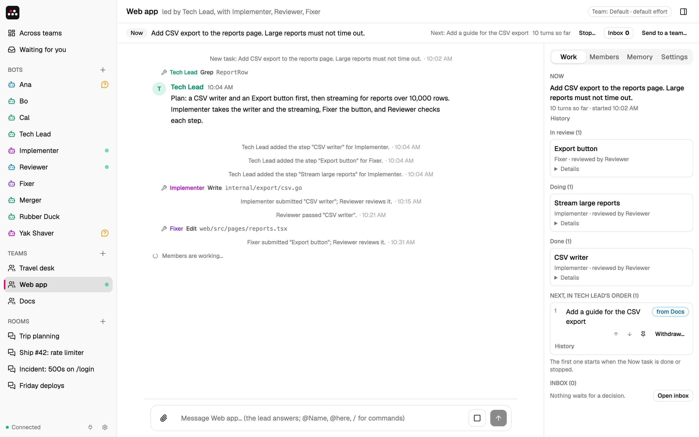

# Handful

**A handful of bots that stay.**

Handful is an open-source app that runs personal AI agents, called bots, on your own Mac or Linux computer. Each bot keeps its own chat, memory, routines and files from one conversation to the next. Put a few bots in a team, and a lead decides what they do next.

Handful runs [Claude Code](https://code.claude.com) on your own subscription. There is no Handful account and no Handful cloud: the server, the database and the bots all run on your machine.


Not affiliated with or endorsed by Anthropic.

## Install and start

You need macOS or Linux, and the Claude Code CLI, version 2.1.319 or later. Sign in to it, and make sure that `claude` is on your `PATH`.

### Mac app

1. Download `Handful-universal-mac.zip` from the [latest release](https://github.com/yarlson/handful/releases/latest), unzip it, and move `Handful.app` to `/Applications`.
2. Open the app. If macOS asks, turn on Handful in System Settings › General › Login Items & Extensions.

The app runs on Apple silicon and Intel Macs. It keeps the server running in the background from login on, and it has an icon in the menu bar. It downloads a new version by itself, and installs it only when you say so. [More about the Mac app](docs/mac-app.md).

### From source

This works on macOS and Linux. You also need [mise](https://mise.jdx.dev), which installs the Go and Node.js versions that build Handful.

```sh
git clone https://github.com/yarlson/handful.git
cd handful
mise install
make build
./bin/handful
```

Then open <http://127.0.0.1:7777>.

## First steps

1. **Start with Builder.** On the first start, Handful has one bot, Builder. Tell it what you want help with, or pick one of its starts: a personal assistant, a software team, a research desk or a writing studio. Builder asks a few questions, then shows the setup on a card. **Create** makes all of its bots, teams and rooms at once.
2. **Talk to a bot.** Write a message and send it. While the bot works, the chat shows each tool that it uses. Then the bot answers. You can send images and videos, and so can the bot.
3. **Answer when a bot asks.** A bot reads files and searches the web without asking. Before it runs a command, changes a file or calls a connector tool, it shows an approval card: **Allow once**, **Always allow** for that tool, or **Deny**.

To make a bot by hand, click **+** next to **Bots**. Give it a name and instructions, for example "Research assistant. Keep answers short."

## What a bot keeps

- **Memory.** Bots remember facts across conversations. They save facts on their own, and you can add yours under **Memory** in the bot panel. A fact with **Always in mind** is in front of the bot on every turn. The other facts go to a journal, which the bot searches when it needs to.
- **Routines.** Ask for anything that repeats, for example "every weekday at 8:10, brief me on my calendar". The bot saves the prompt and the schedule, in your local time. Pause, run or delete a routine in the **Routines** tab.
- **Skills.** A skill is a saved procedure that every bot can use. When you finish a process that you will repeat, a bot can save it as a skill. Run it with `/<skill> <request>`.
- **Artifacts.** Bots save documents for each other: plans, tasks, issues, reviews, reports and notes. All of your bots can read them.
- **A folder.** Each bot works in its own folder, `~/.handful/bots/<bot id>`.

[More about bots](docs/bots.md): Builder's limits, file sizes, chat commands, and who can change what.

## Rooms

A room is a group chat with you and several bots.

Your message wakes the bots that it @mentions, or every member when it mentions no one. The members answer one at a time, so each one sees the earlier replies. A bot's message wakes only the bots that it @mentions.

That is enough to hand work around. In this room, four bots ship a change, and each one @mentions the next:


## Teams

A room is for conversation. A team is for work. It has a lead, a shared folder, a memory of its own, and a working agreement with your rules, for example "Tests pass, and another member checks each change."

Send the team a task in its chat:

```
/task Add CSV export
```

1. **The lead decides.** The task lands in the team's inbox. The lead takes it, asks a question, puts it off, passes it to another team, or pushes it back with a reason.
2. **The members do the steps.** The lead splits the task into steps. Each step has an owner and acceptance criteria. Steps that do not depend on each other run at the same time.
3. **Another member checks.** When your working agreement asks for a check, a second member reviews each step before it is done.
4. **You approve.** When the steps are done, you approve the result or ask for changes.



You do not have to watch a team:

- A lead has 30 minutes to decide on a task. After that, the task comes to you.
- A team can have a budget of turns per day. At the limit, it pauses until midnight or until you raise the limit.
- **Across teams** has one list, **Needs you**: results to approve, decisions that a lead missed, and budgets that ran out.

Teams can also send tasks to each other. [More about teams](docs/teams.md).

## Make it yours

- **Rules for every bot.** Put them in `~/.handful/AGENTS.md`. A bot's own instructions win over this file.
- **Connectors.** A connector gives bots the tools of an external MCP server, such as Slack or a wiki. See [Connectors](docs/connectors.md).
- **Model and effort.** Set them for one bot, for a team's members, or for every bot.
- **Settings.** Click the gear at the bottom of the sidebar.

[Configuration](docs/configuration.md) has the flags, `config.json`, the data folder, the rules for model and effort, and phone access.

## Good to know

- You install Claude Code and sign in to it yourself. Handful starts it on your machine for each turn.
- Your own Claude Code settings, hooks, `CLAUDE.md` files and MCP servers do not reach the bots. Use `AGENTS.md` and connectors instead.
- When a turn reaches your Claude usage limit, Handful starts no new turns until the limit resets. A banner shows when work resumes. Turns that already run go on, and the turn that hit the limit runs again after the reset.
- After a restart, turns that were running are marked interrupted, open approval cards expire, and background tasks are gone.
- Handful keeps all its data in `~/.handful`.
- The UI follows the light or dark mode of your system.

## Security

Handful has no login. It is safe only on a computer that one person uses, and only because of these limits:

- It listens on loopback only.
- It rejects requests whose `Host` is not loopback, to block DNS rebinding.
- It rejects requests from another web origin, to block cross-site request forgery.
- It rejects API POST requests whose body is not JSON.

Bots run as your user. An approved command can do anything that you can do, so read each approval card before you allow it.

Bots are not isolated from each other. Reading files needs no approval and has no path limit. Claude Code's file tools (Read, Grep, Glob) skip Handful's own secrets in the data folder: `ui-key`, `connectors.json`, the tokens in `oauth/`, the per-turn tokens of running bots in `run/`, and the database with its copies (`*.db*` files and `backup/`). A bot can still read them, and any other file, with an approved Bash command, or through a program that such a command runs.

A team keeps its members' work focused on the team, but it is not a security boundary: a member can still read any file, including other teams' folders.

Phone access is off by default. Turned on in **Settings › Phones**, it opens a second loopback address for a proxy on this computer, and every request needs a paired phone. A phone is paired for one of three scopes: **View**, **Chat**, or **Chat and approve once**. A phone never chooses Always allow. A phone paired for Chat can message your bots, and a bot can then use any tool you have already always-allowed for it, with no approval card. With a Cloudflare Tunnel, Cloudflare sees your chats and approvals. [Phone access](docs/configuration.md#phone-access) has the keys and the limits.

## Not built yet

Routines that start on events (only schedules work now), per-bot Claude Code plugins, a vault for secrets, voice, and bots that run on other machines.

## Development

`make build` builds the UI and embeds it in `bin/handful`. `make test` runs the tests, and `make check` runs every check of CI. [Development](docs/development.md) explains the UI, the Mac app, the website, releases, the checks, and how a turn runs.

## License

[MIT](LICENSE)
