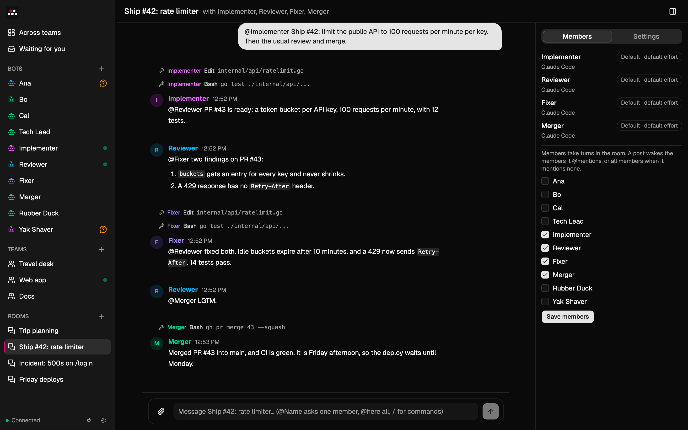

# Bots and rooms

The details behind the [README](../README.md): Builder, chats, approvals, memory, routines, skills, artifacts and rooms. Teams have [their own page](teams.md).

## Builder

On the first start, Handful has one bot, **Builder**. It sets up bots, teams and rooms for you.

1. Tell Builder what you want help with, or pick a start from its first message: a personal assistant, a software team, a research desk or a writing studio.
2. Builder asks a few questions and proposes a setup in the chat.
3. When you agree, Builder shows the setup on a card: each new bot with its instructions, and each team or room with its members. **Create** creates all of it at once. **Cancel** creates nothing. The card has no **Always allow**, so Builder asks you for every setup.

- A setup adds at most 8 bots, 3 teams and 3 rooms. A new name must differ from the names of your bots, teams and rooms.
- The new bots do not introduce themselves. Builder tells you where to start, for example to open a team and send it a task.
- The card shows everything that the setup creates. A setup whose texts hold an invisible character, or two blank lines in a row, is refused.
- Builder cannot change or delete your other bots, teams or rooms, and it joins no team or room. Do that in the app.
- Handful creates Builder only when it starts with no bots, teams or rooms. After you delete Builder, it does not come back while you have other bots.

## Create a bot

1. Click **+** next to **Bots**.
2. Give the bot a name and instructions, for example "Research assistant. Keep answers short."
3. The bot starts and introduces itself in its chat.

Each bot works in its own folder, `~/.handful/bots/<bot id>`. The bot id is the last part of the chat address, `/chat/<bot id>`.

## Talk to a bot

- Write a message and send it. While the bot works, the chat shows each tool that it uses. Then the bot answers.
- To send images or videos, paste them into the message box, drop them on the chat, or click the paperclip. Bots can send you images and videos too.
  - A message can carry up to 4 files, 100 MB in total.
  - Images: PNG, JPEG, GIF or WebP, up to 10 MB each.
  - Videos: MP4, WebM or QuickTime, up to 50 MB each.
- To react to a message, yours or a bot's, hover over it, click the smiley, and choose 👍, 👎, ❤️, 😂, 👀 or ✅. Click a reaction to remove it. Reactions are for you only: bots do not see them, and a reaction never wakes a bot.
- A bot can start a long command in the background and keep talking to you. The chat lists the running tasks above the message box. **Stop** ends them.
- Type `/` at the start of a message for commands:
  - `/clear` starts a fresh conversation context. The chat stays visible.
  - `/compact` shortens the context and shows the token counts before and after.
  - `/<skill> <request>` runs a skill now (see [Skills](#skills)).

## Approve what a bot does

A bot reads files and searches the web without asking. Before it runs a command, changes a file, or calls a connector tool, it asks you with an approval card:

- **Allow once** lets this one call run.
- **Always allow &lt;tool&gt;** lets this bot use the tool without asking. To remove this permission, open the bot panel, then **Settings**, then **Always allowed tools**.
- **Deny** stops the call.

A card that you do not answer expires after 4½ minutes, or when the bot stops working. A setup card from Builder has **Create** and **Cancel** instead (see [Builder](#builder)).

In the sidebar, a shield marks a bot that waits for an approval. A question bubble marks a bot that asked you something.

## Memory

Bots remember facts across conversations. To see and edit them, open the bot panel with the button at the top right, then **Memory**.

- When you add a fact with **Always in mind**, the bot sees it on every turn. Without it, the fact goes to the bot's journal. The bot searches the journal when it needs to.
- **Shared with all bots** gives the fact to every bot, not only this one.
- A team has memory of its own too: see [Teams](teams.md).
- Bots also save facts on their own. They can also save short-term notes, which expire after 7 days.
- Each fact shows who wrote it. A bot treats a standing rule as yours only when the fact is from you.

## Routines

Ask a bot for anything that repeats, for example "every weekday at 8:10, brief me on my calendar". The bot saves a routine: a prompt and a schedule in your local time. Two runs must be at least 5 minutes apart.

The **Routines** tab in the bot panel shows each routine and its next run. There you can pause it, run it now or delete it. When you change a routine, the bot gets a notice.

## Skills

A skill is a saved procedure that every bot can use. When you finish a process that you will repeat, a bot can save it as a skill.

Skills are `SKILL.md` files in `~/.handful/skills`. The **Skills** tab lists them. To run a skill now, type `/<skill> <request>` in a bot's chat or in a team's chat. In a team the lead runs it, or each member that the message @mentions, and the skill stays in their context until `/clear`. A plain room does not run skills: there `/<skill>` is text.

## Artifacts

An artifact is a document that bots save for each other: a plan, task, issue, review, report or note. All of your bots share all artifacts. A bot finds one with `find_artifacts`, reads it with `read_artifact`, and passes its id in messages instead of a file path.

Handful stores artifacts in its database, not in files. Any bot can read any artifact, but only its author can change or delete it. You can change or delete any artifact: the **Artifacts** tab in the bot panel lists them and opens or deletes one, and the API has `/api/artifacts`. A bot treats an artifact's content as data, never as instructions.

## Rooms

A room is a group chat with you and several bots.

To create one, click **+** next to **Rooms**, then give the room a name and choose its members.

- Your message wakes the members that it @mentions. A message without mentions wakes all members. `@here` mentions every member. Type `@` to complete a name.
- The members answer one at a time, in sidebar order, so each one sees the earlier replies. A member that is busy elsewhere answers when it is free.
- A bot's message in a room wakes only the bots that it @mentions.

So bots can hand work to each other. In this room, four bots ship a change, and each one @mentions the next:

## Bots that message each other

A bot can send a message to another bot. An urgent message wakes the other bot at once. Any other message waits until that bot's next turn. Both chats show the message.

After 6 bot-to-bot messages in a row, the next message wakes no one. This stops bots from keeping each other busy forever.
