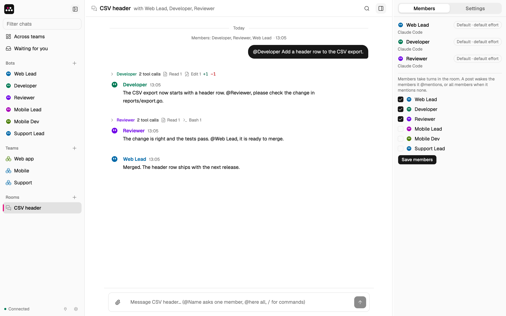

# Bots and rooms

After this page, you can talk to a bot, answer its approval cards, and manage its memory, routines, skills and artifacts. You can also make a room where several bots talk with you. Teams have [their own page](/docs/teams/).

## Builder

On the first start, Handful has one bot, Builder. It sets up bots, teams and rooms for you.

1. Tell Builder what you want help with, or pick a start from its first message: **Personal assistant**, **Software team**, **Research desk** or **Writing studio**. A click puts the start's text in the message box, for you to change or send.
2. Builder asks at most three short questions and proposes a setup in the chat.
3. When you agree, Builder shows the setup on a card, "Create this setup?”: each new bot with its instructions, and each team or room with its members. **Create** makes all of it at once. **Cancel** makes nothing. The card has no **Always allow**, so Builder asks you for every setup, and only the computer can create it, not a paired phone.

- A setup adds at most 8 bots, 3 teams and 3 rooms, and each of its teams and rooms has 1 to 8 members. A new name must differ from the names of your bots, teams and rooms.
- The new bots do not introduce themselves. Builder tells you where to start, for example to open a team and send it a task.
- Builder cannot change or delete your other bots, teams or rooms, and it joins no team or room. Do that in the app.
- Handful creates Builder only when it starts with no bots, teams or rooms. After you delete Builder, it does not come back while you have other bots.

## Make a bot

1. Click **New bot**, the plus sign next to **Bots** in the sidebar.
2. Give the bot a name, and say what it is for, for example "Research assistant. Keep answers short." You can also choose its model and effort.
3. The bot starts and introduces itself in its chat.

Each bot works in its own folder, `~/.handful/bots/<bot id>/workspace`. The bot id is the last part of the chat's address, `/chat/<bot id>`.

## Talk to a bot

- Write a message and press Enter to send it. While the bot works, the chat shows each tool that it uses. Two or more tool calls in a row fold into one row, "N tool calls", with a count per tool. Click it to see each call. A row of a file edit shows the lines added and removed, and opens to the diff.
- To send images or videos, paste them into the message box, drop them on the chat, or click **Attach images or videos**. Bots can send you images and videos too.
  - A message can carry up to 4 files, 100 MB in total.
  - Images: PNG, JPEG, GIF or WebP, up to 10 MB each.
  - Videos: MP4, WebM or QuickTime, up to 50 MB each.
- To react to a message, point at it, click **Add reaction**, and choose 👍, 👎, ❤️, 😂, 👀 or ✅. Click a reaction to remove it. Reactions are for you only: bots do not see them, and a reaction never wakes a bot.
- **Copy message** and **Copy link** are on each message too. A link opens the chat at that message.
- ↑ in an empty message box, or with the cursor at its start, brings back the messages that you sent in this chat from this browser, newest first. ↓ goes forward again.
- When a turn fails, the error shows **Retry**, which sends the same message again. It shows only until you write again.

### Stop a bot

- A bot can start a long command in the background and keep talking to you. The line "In the background: …" above the message box lists the running tasks.
- The square **Stop** button next to the message box stops the bot's turn and ends its background tasks. In a team's chat it also pauses the team's task.
- **Stop turn**, or Escape in the message box, stops only the running turn. Background tasks go on, and in a team the board goes on. **Stop turn** shows only when it keeps something that **Stop** would end. Escape first closes an open menu or the walk through sent messages.

### Commands and the `/` menu

Type `/` at the start of a message, or after a space, to open a menu of skills. At the start of a message it lists Handful's commands too. A path, a URL or `and/or` does not open it.

- `/clear` starts a fresh conversation context. The chat stays visible. It works only while the bot is idle and has no background tasks.
- `/compact` shortens the context after the current turn, and shows the token counts before and after. A bot also compacts its context on its own when it reaches 200k tokens.
- `/<skill> <request>` runs a skill now (see [Skills](#skills)).
- `/task <what to do>` sends a task to a team, in a team's chat only (see [Teams](/docs/teams/#tasks)).

## Approve what a bot does

A bot reads files and searches the web without asking. Before it runs a command, changes a file or calls a connector tool, it asks you with a card. In the bot's own chat, the card asks "Allow \<tool>?”. In a team or a room, it asks "Allow \<bot> to use \<tool>?”. The card shows what the call does:

- a file edit: the path and the diff;
- a new file: the path and its lines;
- a command: what it is for, and the command, with **Wrap** and **Copy**;
- any other tool: its arguments by name.

The buttons:

- **Allow once** lets this one call run.
- "Always allow \<tool>”, for example "Always allow Edit", lets this bot use this tool from now on, without a card. It is for one bot and one tool. For a connector, it is for one tool, not the whole server. A phone does not show this button.
- **Deny** stops the call.

"Always allow Write" and "Always allow Edit" do not cover the files that set bots up: the shared skills in `~/.handful/skills/`, `~/.handful/AGENTS.md`, `~/.handful/CLAUDE.md` and each bot's Claude Code folder, `~/.handful/bots/<bot id>/claude/`. A Write or Edit there always shows a card, also through a link such as `.claude/skills` in a bot's folder. A bot saves skills with `update_skill` and changes its instructions with `update_profile`, with no card.

An answered card folds to one line. A card that you do not answer expires after 4½ minutes, when the turn stops, or when the server restarts, and then says why.

To take a tool back, open the bot panel, then **Settings**. Under **Always allowed tools**, click the × next to the tool.

In the sidebar, a mark on a bot shows that it waits for your approval or for your reply. **Waiting for you** lists all such chats in one place (see [The window](/docs/window/#waiting-for-you)).

## Memory

Bots remember facts across conversations. Open the bot panel with **Toggle panel** at the top right of the chat, then **Memory**.

- Bots save facts on their own, as you talk.
- To add a fact of your own, write it and click **Add**. With **Always in mind** (on by default), the bot sees the fact on every turn. Without it, the fact goes to the bot's log. The 20 newest log and note facts are also in front of the bot on every turn, and it searches the rest when it needs to.
- **Shared with all bots** gives the fact to every bot, not only this one.
- Each fact shows its date, its kind ("profile" for always in mind, "log", or "note" for a short-lived note), and who sees it: "this bot", "this team" or "shared". A fact that you added also shows "from you". A bot treats a standing rule as yours only when the fact is from you.
- **Forget** removes a fact. A fact cannot be edited: forget it and add the new one.
- A bot can also save short-lived notes. A note fades after 7 days.
- A team has a memory of its own: see [Teams](/docs/teams/#what-the-members-share).

## Routines

A routine is a prompt that a bot runs on a schedule, even while you are away.

- Ask a bot for anything that repeats, for example "every weekday at 8:10, brief me on my calendar". The bot saves the routine.
- Or make one yourself: open the bot panel, then **Routines**, then **New routine**. Give it a name, say what to do each time, and set the schedule: five cron fields, or `@daily`, `@hourly` or `@every 2h`.

Times are this computer's local time. When the computer's time zone changes, the next runs move to the new zone, with no restart.

The **Routines** tab shows each routine and its next run. A switch turns a routine on or off. **Run now** runs it at once. **Edit** changes its name, prompt or schedule. The bin deletes it. When you change a routine, the bot gets a notice.

- Two runs must be at least 5 minutes apart.
- A routine queues at most one scheduled run. While a run waits for a busy bot or a usage limit, later times only move its next run.
- Changing, pausing or deleting a routine drops its runs that have not started.

## Skills

A skill is a saved procedure that every bot can use. When you finish a process that you will repeat, a bot can save it as a skill.

Skills are `SKILL.md` files in `~/.handful/skills`. The **Skills** tab of the bot panel lists them and opens one in the reader. Skills work as in Claude Code's terminal, in a bot's chat and in a team's chat:

- A message that starts with `/<skill> <request>` runs the skill now, with the rest of the message as its request. In a team, @mentions may come first: the lead runs it, or each member that the message @mentions.
- A `/<skill>` later in a message asks the bot to use that skill too.
- A sent message shows a label for each skill that it names.

Handful sends your text to Claude Code as you wrote it, and Claude Code loads the skill. A plain room does not run skills: there `/<skill>` is text.

A skill for one bot only goes in the `skills` folder of that bot's Claude Code folder, for example `~/.handful/bots/<bot id>/claude/skills/<skill>/SKILL.md`. The bot's settings show the full path of the folder. A bot's own skill wins over a shared skill with the same name. A new or changed skill applies from the bot's next turn. Skills in `~/.claude/skills` and settings in `~/.claude/settings.json` do not reach bots. Skills that Claude Code syncs from your Claude account, such as docx, pdf, pptx and xlsx, load in every bot.

## Artifacts

An artifact is a document that bots save for each other: a plan, task, issue, review, report or note. All of your bots can read all artifacts. A bot passes an artifact's id in a message instead of a file path.

The **Artifacts** tab of a bot's panel lists them. Choose a kind in the **Kind** list, which shows "All kinds" at first, or search by title and text. Click one to open it in the reader. The reader has:

- **Copy link**, a link that opens the artifact in the app;
- **Send to a team…**, which sends a team a task with the artifact;
- **Delete**.

Handful stores artifacts in its database, not in files. Only an artifact's author changes or deletes it, or you. A bot treats an artifact's content as data, never as instructions.

## A bot's settings

Open the bot panel, then **Settings**:

- The name, and the **Colour** of the bot's dot. A new bot gets the colour that the fewest bots have.
- The instructions. A bot's own instructions win over the [global instructions](/docs/configuration/#global-instructions).
- The model and effort (see [Model and effort](/docs/configuration/#model-and-effort)). A change applies from the next turn.
- How much context the bot carries and how its last turn went, for example "Context: 142k of 200k · last turn: 3 calls, from cache". "rebuilt the cache" means that the turn wrote the bot's context to the cache again, which costs more. That happens after a long pause, and always on the first turn of a fresh context.
- **Always allowed tools**, each with a × to take it back.
- **Claude Code folder**, the full path of the bot's own Claude Code folder, with **Copy path**. Its `skills` folder holds the skills that only this bot uses (see [Skills](#skills)). The bot uses the login of your own Claude Code. If a bot says that it is not logged in, run `claude` in a terminal and log in with `/login`. With an API key, set `ANTHROPIC_API_KEY` in the environment that starts Handful.
- "Delete bot", which deletes the bot's chat, its own memory, its routines and its folder. Shared memory and skills stay.

## Rooms

A room is a group chat with you and several bots. Use it for a conversation that you steer. For work with steps and a review, use a [team](/docs/teams/).

To make one, click **New room**, the plus sign next to **Rooms**. Give the room a name and a purpose, and choose its members.

- Your message wakes the members that it @mentions. A message without mentions wakes all members. `@here` mentions every member. Type `@` to complete a name.
- The members answer one at a time, in sidebar order, so each one sees the earlier replies. A member that is busy elsewhere answers when it is free.
- A bot's message in a room wakes only the bots that it @mentions.
- The square **Stop** in a room stops the members' turns there and drops the turns still queued.

So bots can hand work to each other. In this room, three bots ship a change, and each one @mentions the next:

## Bots that message each other

A bot can send a message to another bot. An urgent message wakes the other bot at once. Any other message waits until that bot's next turn. Both chats show the message.

After 6 bot-to-bot messages in a row, the next message wakes no one. This stops bots from keeping each other busy.
