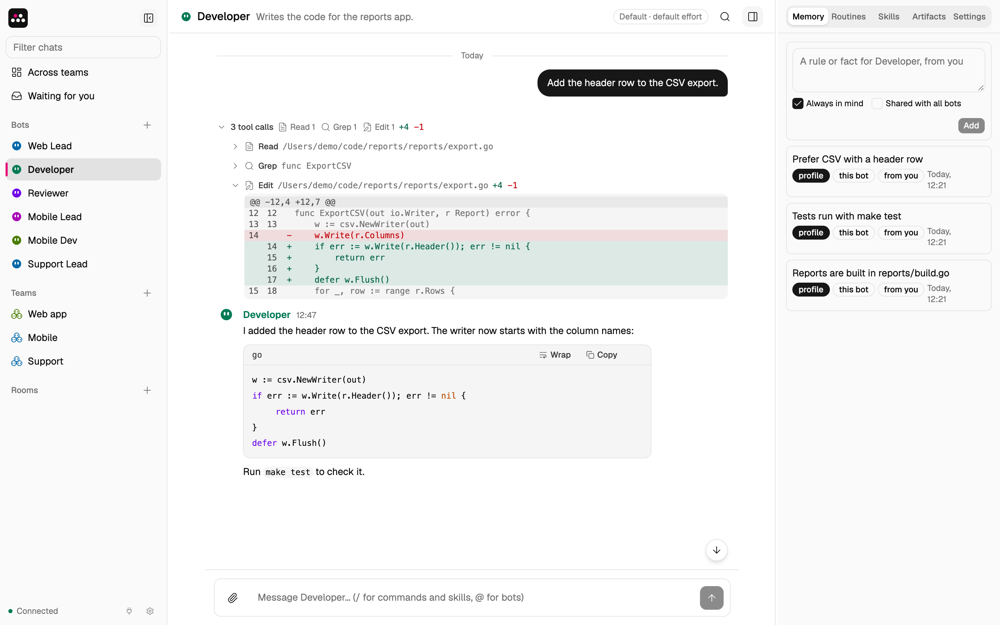

# First steps

After this page, Handful runs on your computer, Builder has made your first bot or team, and you know what an approval card asks.

Handful is an open-source app that runs AI agents, called bots, on your own Mac or Linux computer. It runs [Claude Code](https://code.claude.com) on your own subscription. There is no Handful account and no Handful cloud: the server, the database and the bots all run on your machine.



## What you need

- macOS or Linux.
- The Claude Code CLI, version 2.1.319 or later. Sign in to it, and make sure that `claude` is on your `PATH`.

## Install

### Mac app

1. Download `Handful-universal-mac.zip` from the [latest release](https://github.com/yarlson/handful/releases/latest), unzip it, and move `Handful.app` to `/Applications`.
2. Open the app. If macOS asks, turn on Handful in System Settings › General › Login Items & Extensions.

The app runs on Apple silicon and Intel Macs. It keeps the server running in the background from login on, and it has an icon in the menu bar. It downloads a new version by itself, and installs it only when you say so. See [The Mac app](/docs/mac-app/).

### From source

This works on macOS and Linux. You also need [mise](https://mise.jdx.dev), which installs the Go and Node.js versions that build Handful.

```sh
git clone https://github.com/yarlson/handful.git
cd handful
mise install
make build
./bin/handful
```

Then open <http://127.0.0.1:7777>. The browser asks for Handful's key once: run `cat ~/.handful/ui-key` in a terminal, paste the key, and click **Save key**. [Handful's key](/docs/configuration/#handfuls-key) says what the key is for.

## The first ten minutes

### 1. Start with Builder

On the first start, Handful has one bot, Builder. It sets up bots, teams and rooms for you.

Builder's first message offers four starts: **Personal assistant**, **Software team**, **Research desk** and **Writing studio**. A click puts the start's text in the message box. Change the text or send it as it is. You can also write in your own words what you want help with.

Builder asks a few questions and proposes a setup in the chat. When you agree, it shows the setup on a card, "Create this setup?”, with each new bot and its instructions, and each team or room with its members. **Create** makes all of it at once. **Cancel** makes nothing.

For a team that changes code, go on with [Run a software team](/docs/software-team/).

### 2. Send a first message

Open a bot's chat in the sidebar, write a message and send it. While the bot works, the chat shows each tool that it uses. Two or more tool calls in a row fold into one row, "N tool calls". Click the row to see each call. Then the bot answers.

You can send images and videos, and so can the bot.

### 3. Answer the first approval card

A bot reads files and searches the web without asking. Before it runs a command, changes a file or calls a connector tool, it shows a card. In the bot's own chat, the card asks "Allow \<tool>?”. In a team or a room, it asks "Allow \<bot> to use \<tool>?”. For a file change, the card shows the path and the diff. For a command, it shows what the command is for and the command itself.

- **Allow once** lets this one call run.
- "Always allow \<tool>”, for example "Always allow Edit", lets this bot use this tool from now on without a card. A phone does not show this button.
- **Deny** stops the call.

A card that you do not answer expires after 4½ minutes. Bots run as your user, so a command that you allow can do anything that you can do. Read each card. [Security and data](/security/) has the whole list of limits.

### 4. Make a bot by hand

Click **New bot**, the plus sign next to **Bots** in the sidebar. Give the bot a name and say what it is for, for example "Research assistant. Keep answers short." The bot starts and introduces itself in its chat.

## What a bot keeps

Close the app and come back later. Each bot still has:

- Its chat. The whole conversation stays, with the tools that the bot used.
- Its memory. A bot saves facts on its own, and you add yours in the **Memory** tab of the bot panel. A fact with **Always in mind** is in front of the bot on every turn. The other facts go to the bot's log. The 20 newest of them are also in front of the bot on every turn, and it searches the rest when it needs to.
- Its routines. Ask for anything that repeats, for example "every weekday at 8:10, brief me on my calendar". The bot saves the prompt and the schedule. Make, change and run routines in the **Routines** tab.
- Skills. A skill is a saved procedure that every bot can use. Run one with `/<skill> <request>`.
- Artifacts. Bots save documents for each other: plans, tasks, issues, reviews, reports and notes. All of your bots can read them.
- Its folder, `~/.handful/bots/<bot id>/workspace`.

[Bots and rooms](/docs/bots/) has the details.

## Good to know

- You install Claude Code and sign in to it yourself. Handful starts it on your machine for each turn.
- Your own Claude Code settings, hooks and MCP servers, and the `CLAUDE.md` files in your home folder and `~/.claude`, do not reach the bots. Use [global instructions](/docs/configuration/#global-instructions) and [connectors](/docs/connectors/) instead.
- When a turn reaches your Claude usage limit, Handful starts no new turns until the limit resets. A banner shows when work resumes. Turns that already run go on, and the turn that hit the limit runs again after the reset.
- After a restart of the server, turns that were running are marked interrupted, open approval cards expire, and background tasks are gone.
- Handful keeps all its data in `~/.handful`.
- Handful has no login. Use it only on a computer that one person uses.

## Where to go next

- [Run a software team](/docs/software-team/): one reviewed change from a team of three bots.
- [The window](/docs/window/): the sidebar, search, the palette, the panel and the shortcuts.
- [Teams](/docs/teams/): how a task moves from the inbox to your approval.
- [Phone access](/docs/phone/): read, chat and approve from your phone.
