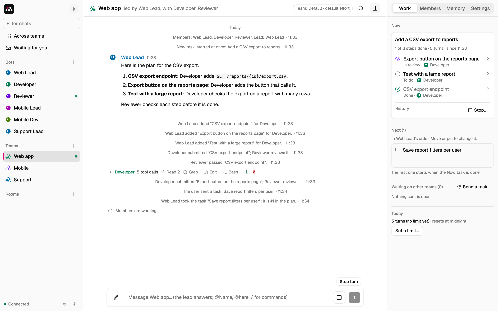

# Run a software team

After this page, a team of three bots has made one change to your code, a second bot has reviewed it, and you have approved the result.

You need Handful installed ([First steps](/docs/first-steps/)) and a folder with your code on this computer.



## 1. Make the team

### With Builder

1. Open Builder's chat. On a new install, click **Software team** in its first message. The text "Set up a software team: a lead, a developer and a reviewer who change my code and check it with tests." goes into the message box. Later, write the same request yourself.
2. Send it. Builder asks a few short questions. Tell it where your code is, for example `~/code/reports`, so that the folder goes into the team's purpose.
3. Builder proposes the setup in the chat. When you agree, it shows the card "Create this setup?". Read the instructions of each bot and the team's working agreement on the card, then click **Create**.

Builder's starter for this request is a team of three: a lead who plans and splits the work, a developer who writes code with tests, and a reviewer who checks each change. Its working agreement is "Tests pass, and another member reviews each change." Builder adapts names and size to your answers, so check the card.

### By hand

1. Make three bots with **New bot**: a lead, a developer and a reviewer. Give each one instructions that start with its role.
2. Click **New team**, the plus sign next to **Teams**. Give the team a name. In the purpose, name the folder with your code. Choose the members and the lead, and write the working agreement.

## 2. Check the rules

Open the team's chat, then the panel, then **Settings**.

- The purpose names the folder with the code. Every member reads the purpose on each turn in the team. Each bot also has its own folder, and the team has a shared folder, `~/.handful/teams/<team id>/workspace`, for the team's notes and files.
- The working agreement holds your rules for how the team works and when work is done. Inside the team, it overrides each member's own instructions on how work is done and checked. A step gets a reviewer when the agreement asks for a check.
- Say in the agreement who commits, who pushes and who merges, for example "Open a pull request. Only I merge." Handful has no merge step of its own. A bot merges only with a command, and a command asks you first.

The agreement is an instruction to the bots. It is not a lock. The approval cards are the lock.

## 3. Send a task

Type `/task` and what the team should do in the team's chat:

```
/task Add a CSV export to the reports page
```

The task lands in the team's inbox, and the lead decides on it: take it, ask you a question, put it off, pass it to another team or push it back with a reason.

To skip the inbox, click **New task…** in **Across teams**, write the task, and tick **Start now**. The task then becomes the Now task at once when the team has none, and otherwise it goes first in the plan. The lead is told.

## 4. Watch the work

Open the panel on the **Work** tab.

- **Now** shows the task in work and its steps. Each step has one owner, and "reviewed by" names its reviewer. A step is **To do**, **Doing**, **In review**, **Blocked**, **Done** or **Dropped**.
- The chat shows what each member does: its tool calls, folded into one row, and its messages to the team.
- Click a step to read its brief, its acceptance criteria and its history.

Steps that do not depend on each other can run at the same time when different members own them. A bot runs one turn at a time.

## 5. Answer the cards

A member asks before it runs a command or changes a file. The card shows the diff or the command. For the first task, answer each card with **Allow once** and read what the bots do.

When you know the team, the button "Always allow <tool>", for example "Always allow Edit", saves cards. It is for one bot and one tool, and a phone does not show it:

- Edit and Write for the developer are the usual choice. The card that remains is the command.
- Bash for any bot lets that bot run every command without a card: tests, but also `git push`, a merge or a delete. Allow it only when you accept that.
- Never always allow Bash for the reviewer. While a bot reviews a step, Handful denies it Edit and Write in that team, even when you always allow them. Bash can still change files.

To take a permission back, open the bot's own chat, then the panel, then **Settings**. Under **Always allowed tools**, click the × next to the tool.

**Waiting for you** in the sidebar lists every chat where a bot waits for you: an open card, a question or a paused task.

## 6. Read a review round

When the owner submits a step, the reviewer reads the result. It passes the step or asks for changes. A request for changes shows on the step as "Changes asked · round 1" with the reviewer's text, and the step goes back to its owner.

Every third request for changes on a step blocks it. Then the lead decides what to do, and can ask you in the chat.

## 7. Approve the result

When every step is done or dropped, the lead closes the task with a result. The task then waits for you:

- In the team's **Work** tab and in **Across teams**, **Needs you** shows the line "Approve: … is done".
- **Approve** accepts the result. **Ask for changes…** sends the task back with your text. It is the Now task again when the team has none, and otherwise it goes first in **Next**.

Before you approve a code change, read the diff or the pull request yourself. A review by a bot does not find everything.

After you approve, the lead looks back on the task once and is asked to save up to 5 lessons in the team's memory. Read them in the team panel, under **Memory**.

## 8. Set a budget

A new team has no limit on turns. To set one, open the team's **Settings** and fill in **Turns per day**. 0 is no limit.

At 80% of the limit, **Needs you** in **Across teams** warns you. At the limit the team pauses until midnight or until you raise the limit. Running turns finish. While the team has no limit, the Work tab on the computer suggests one after a week, from the team's own use.

## 9. Choose model and effort per member

Each bot can have its own model and reasoning effort, in the bot's **Settings**. A team can give its members a default, in the team's **Settings** under **Member defaults**. A common setup is a stronger model for the lead and the reviewer. The **Members** tab shows each member's values and where they come from. [Model and effort](/docs/configuration/#model-and-effort) has the order.

## 10. Add a second team

Teams pass work to each other as tasks. For example, a Product team writes a spec and sends it to a Dev team, or a Support team sends a bug.

- A lead sends a task with a brief and any artifacts. You can too, with **Send a task…** in a team's **Work** tab.
- The task lands in the other team's inbox, and its lead decides on it, as on any task.
- The team that sent the task approves the result. The team that does the task pays for it from its own budget.

[Teams](/docs/teams/#teams-that-work-together) has the rules and the limits.

## When something stops

- A lead that does not decide in time: after the team's decision time, 30 minutes by default, the task comes to you in **Needs you**.
- A member that stops without handing its step on, for example after a failed turn or a restart: the step is blocked, and the lead decides.
- To stop only the running turn, click **Stop turn** or press Escape. To pause the whole task, click the square **Stop** button in the team's chat. The Now card then shows **Paused** and **Resume**.
- A team is not a sandbox. Its members run as your user and can read any file on the computer. See [Security and data](/security/).
