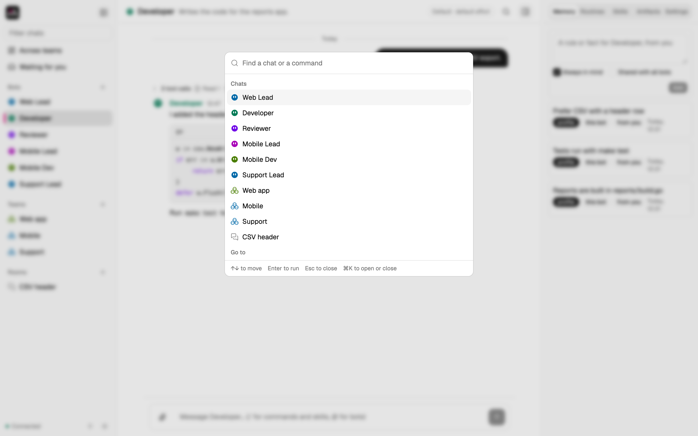

# The window

After this page, you can find any chat, message or command fast, and set up the window the way you like it.

The window has three parts: the sidebar on the left, the chat in the middle, and the panel on the right.

## Shortcuts

| Keys on a Mac | Keys on Linux | What they do |
|---|---|---|
| ⌘K | Ctrl+K | Open the command palette |
| ⌘F | Ctrl+F | Search this chat |
| ⌘B | Ctrl+B | Collapse or open the sidebar |
| ⌥⌘B | Ctrl+Alt+B | Close or open the panel |
| Enter | Enter | Send the message |
| Shift+Enter | Shift+Enter | A new line in the message |
| ↑ and ↓ | ↑ and ↓ | Bring back messages that you sent in this chat from this browser |
| Escape | Escape | Close a menu, then stop the running turn |

The shortcuts use the place of the key on the keyboard, not its letter, so they work with any keyboard layout. A button's tooltip shows its shortcut.

## The sidebar

From top to bottom:

- **Filter chats** narrows the list to the chats whose names match.
- **Across teams** shows every team at once, with a count of what needs you (see [Teams](/docs/teams/#across-teams)).
- **Waiting for you** lists the chats where a bot waits for you (below).
- **Bots**, **Teams** and **Rooms**, each with a plus sign: **New bot**, **New team** and **New room**.
- At the bottom: **Connectors** and **Settings**.

A mark next to a chat says what is going on: **Working**, **Background tasks**, **Needs your approval**, **Waiting for your reply**, **The task is paused**, **Check the bot's model** or **Unread**.

**Collapse sidebar** (⌘B) hides the sidebar, and **Open sidebar** brings it back. Drag the sidebar's edge to change its width, from 180 to 480 pixels. Double-click the edge to reset it. The width is saved in this browser.

## Waiting for you

**Waiting for you** in the sidebar shows a count, and opens one list of every chat where a bot waits for you:

- an open approval card;
- an open question, which a bot marked as one that it cannot go on without;
- a paused task.

The list groups the open questions by chat. Each group has the chat's name and **Open chat**. Each question shows who asks and when, with **Answer** and **Dismiss**. After **Dismiss**, **Undo** takes it back for 10 seconds. A device that may not send messages shows no **Answer** and no **Dismiss**.

The section "Approvals and paused tasks" lists each chat with an open card, as "<name>: needs your approval", and each chat with a paused task, as "<name>: the task is paused". Click a line to open the chat.

At the bottom, a line counts the questions answered or dismissed in the last 7 days. **Show** opens them. When nothing waits, the list says "Nothing is waiting for you."

A chat with open questions also shows them above its message box, under "Open questions (N)". Each one has **Go to**, which jumps to the message, **Answer** and **Dismiss**. When there are many, the strip shows only the first, and "Show all N" opens the rest.

## Search this chat

Click **Search this chat**, the magnifier in the chat header, or press ⌘F. Type 2 to 200 characters. The results are the 50 newest messages of this chat that match, newest first. Choose one to jump to it in the chat. Escape closes the search.

## The command palette

Press ⌘K, or Ctrl+K on Linux, and type in the box "Find a chat or a command". The palette has three groups:

- **Chats**: every bot, team and room.
- **Go to**: **Waiting for you**, and each section of Settings, for example "Settings: General".
- **Actions**: **New bot**, **New team**, **New room** and **Toggle sidebar**. When a chat is open, also **Toggle panel** and **Search in this chat**. Then the themes: "Theme: System", "Theme: Light" and "Theme: Dark".

Enter runs the selected line. Escape closes the palette. A phone's palette has fewer lines; see [Phone access](/docs/phone/).

## The chat

- Day separators split the chat by day: "Today", "Yesterday", then the day and date.
- Two or more tool calls in a row fold into one row, "N tool calls", with a count per tool and the number that failed. Click it to see each call. A file edit shows the lines added and removed and opens to its diff. A diff that is too large says so instead.
- Code blocks show their language, **Wrap** for long lines, and **Copy**. A table has **Copy table**.
- Click an image to open it large. Zoom with + and −, fit it to the screen with 0, and show it at its real size with 1. When it is zoomed in, the arrow keys move it.
- When a turn fails, its error shows **Retry**, which sends the same message again, until you write again.
- **Jump to latest** shows when you scroll up, and takes you back to the newest message.
- When Claude usage reaches its limit, a banner says "Claude usage limit reached. New turns wait until …", with the time. Close it, and it stays closed until that time changes.

The chat header shows the chat's name, a team's **Now** chip, and the model of a bot or a team. Click a bot's model to open its **Settings**, or a team's to open **Members**.

## The panel

**Toggle panel**, at the right of the chat header, or ⌥⌘B, opens and closes the panel. Drag its edge to change its width, from 280 to 560 pixels. Double-click the edge to reset it.

Its tabs depend on the chat:

| Chat | Tabs |
|---|---|
| A bot | **Memory**, **Routines**, **Skills**, **Artifacts**, **Settings** |
| A team | **Work**, **Members**, **Memory**, **Settings** |
| A room | **Members**, **Settings** |

[Bots and rooms](/docs/bots/) and [Teams](/docs/teams/) say what each tab does.

### The reader

An artifact or a skill opens in the reader, in place of the chat. **Back to chat** closes it. For an artifact, the reader has **Copy link**, **Send to a team…** and **Delete**. A link from **Copy link** opens the same artifact in the app.

## Settings

Click **Settings** at the bottom of the sidebar, or use ⌘, in the Mac app. Its sections are **General**, **Appearance**, **Updates**, **Connectors**, **Phones**, **Runtime** and **Settings file**. [Configuration](/docs/configuration/) has the details.

### Appearance

- **Theme**: System, Light or Dark. System follows the light or dark mode of this device.
- **Chat width**: Normal or Wide.
- **Text size**: Medium or Large.

These are saved in this browser only, so each computer and phone can look different.

## A narrow window

- Below 1024 pixels wide, the panel opens over the chat.
- Below 768 pixels, the window takes the phone layout: the sidebar is a drawer that slides in, and the panel is a sheet that fills the screen.

A phone uses the same layout. [Phone access](/docs/phone/) says what a paired phone can do.
